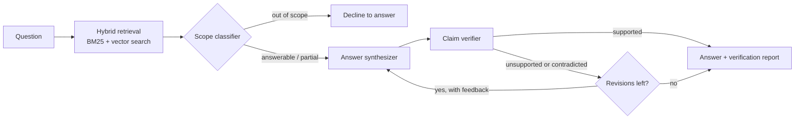

# FactLens

An advanced RAG-based document analysis assistant focused on explainable, verifiable answers.

FactLens answers questions about long, complex documents (PDF, DOCX, TXT, MD) and checks every
answer against the passages it came from before showing it to you. If your documents don't
contain the answer, it says so instead of guessing.

## How it works



1. **Ingestion**: [Docling](https://github.com/docling-project/docling) turns PDFs and DOCX files
   into structured Markdown (tables included, OCR for scans). The Markdown is split by heading and
   then into size-bounded chunks. Parsed chunks are cached on disk by file hash.
2. **Hybrid retrieval**: BM25 keyword search and OpenAI-embedding vector search (Chroma) are
   merged with weighted reciprocal-rank fusion.
3. **Scope classifier**: decides whether the retrieved passages can answer the question at all.
4. **Answer synthesizer**: drafts an answer using only the retrieved context.
5. **Claim verifier**: checks the draft for unsupported claims, contradictions and relevance. A
   failed check sends the draft back for revision with the verifier's feedback, up to
   `FACTLENS_MAX_REVISIONS` times.

## Quick start

Requires Python 3.11 or newer and an [OpenAI API key](https://platform.openai.com/api-keys).

```bash
git clone https://github.com/punyatoya-github/FactLens.git
cd FactLens

# Using uv (recommended; installs exactly the versions in uv.lock)
uv sync --extra dev
cp .env.example .env        # then put your OPENAI_API_KEY in .env
uv run factlens
```

Or with pip:

```bash
python -m venv .venv && source .venv/bin/activate
pip install -e ".[dev]"
cp .env.example .env
factlens
```

Open <http://127.0.0.1:7860>, upload one or more documents (or load a bundled example), ask a
question and press **Submit**. The first PDF takes a while because  loads its models;
repeat questions about the same files reuse the cached parse and stored embeddings.

> **Privacy:** document text is sent to OpenAI for embedding and answering. The app listens on
> localhost only and does not create a public share link unless you set `FACTLENS_SHARE=true`.

## First-run speed

The first time you upload a long PDF, FactLens has to convert it with 's layout and table
models, which can take several minutes on a CPU. The UI shows a status line while this happens, the
console logs how long each file took, and the result is cached in `.factlens/cache`, so asking
more questions about the same files is fast.

's OCR is the most expensive step on image-heavy reports, so by default FactLens parses
PDFs **without** OCR and retries with OCR only when a PDF yields almost no text (a scan). Set
`FACTLENS_OCR_MODE=never` to skip that fallback, or `always` to OCR everything. Table recognition
stays on in every mode. Messages like `RapidOCR returned empty result!` just mean OCR looked at
an image with no text in it (a chart, photo or logo).

## Configuration

Settings come from environment variables or a `.env` file (see [.env.example](.env.example)).

| Variable | Default | Purpose |
|---|---|---|
| `OPENAI_API_KEY` | (required) | OpenAI credentials |
| `FACTLENS_CHAT_MODEL` | `gpt-6-luna` | Chat model used by all agents |
| `FACTLENS_SCOPE_MODEL`, `_SYNTHESIS_MODEL`, `_VERIFICATION_MODEL` | unset | Per-agent overrides |
| `FACTLENS_EMBEDDING_MODEL` | `text-embedding-3-small` | Embedding model |
| `FACTLENS_CHAT_TEMPERATURE` | unset | Leave unset unless your model accepts it |
| `FACTLENS_OCR_MODE` | `auto` | `auto`, `never` or `always`; see [First-run speed](#first-run-speed) |
| `FACTLENS_MAX_REVISIONS` | `2` | Revisions allowed after a failed verification |
| `FACTLENS_VECTOR_SEARCH_K` / `_BM25_SEARCH_K` | `10` / `4` | Results per retriever |
| `FACTLENS_HYBRID_WEIGHTS` | `[0.4,0.6]` | Fusion weights `[lexical, vector]` |
| `FACTLENS_CHUNK_MAX_CHARS` / `_CHUNK_OVERLAP_CHARS` | `2000` / `200` | Chunk size |
| `FACTLENS_DATA_DIR` | `.factlens` | Parse cache and vector store (safe to delete) |
| `FACTLENS_SERVER_HOST` / `_SERVER_PORT` / `_SHARE` | `127.0.0.1` / `7860` / `false` | Web server |

OpenAI retires models on a published schedule. Check the
[deprecations page](https://developers.openai.com/api/docs/deprecations) and change
`FACTLENS_CHAT_MODEL` if your default is deprecated.

## Project layout

```
src/factlens/
├── core/         settings, logging, constants, errors
├── ingestion/    parsing, chunking, hashing, upload handling
├── storage/      JSON chunk cache
├── retrieval/    BM25, vector store, weighted rank fusion
├── llm/          OpenAI chat and embedding clients
├── agents/       scope_classifier, answer_synthesizer, claim_verifier
├── pipeline/     LangGraph graph and runner
├── schemas/      typed verdicts and results
└── ui/           Gradio app, rendering, bundled examples
tests/            offline unit and integration tests (no network)
scripts/          developer utilities (e.g. inspect_parsing.py)
examples/         sample documents
```

## Development

```bash
uv run pytest            # tests (no API key or network needed)
uv run ruff check .      # lint
uv run ruff format .     # format
uv run mypy              # type check
uv run python scripts/inspect_parsing.py examples/deepseek-r1-technical-report.pdf
```

See [CONTRIBUTING.md](CONTRIBUTING.md) for conventions.

## License

MIT. See [LICENSE](LICENSE). Author: Punyatoya Mohanty.
